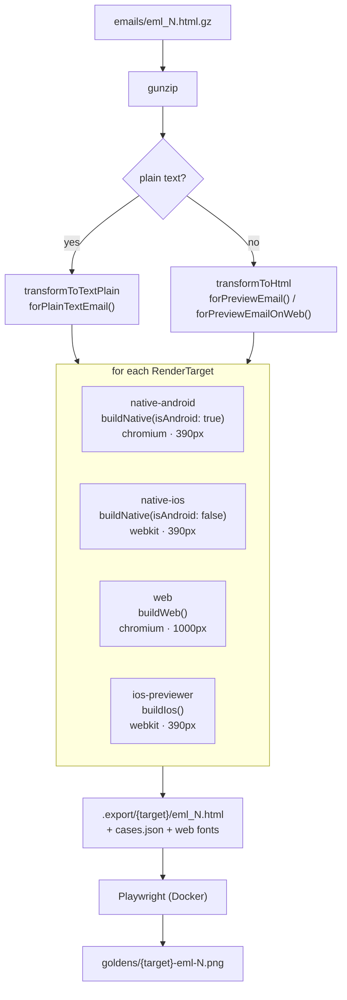
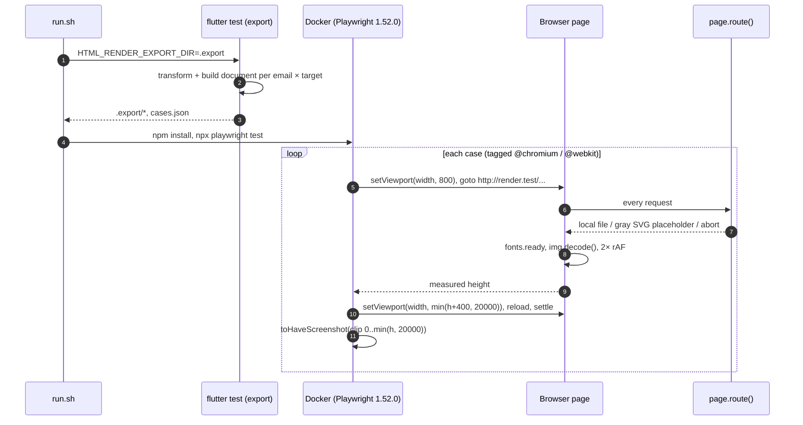
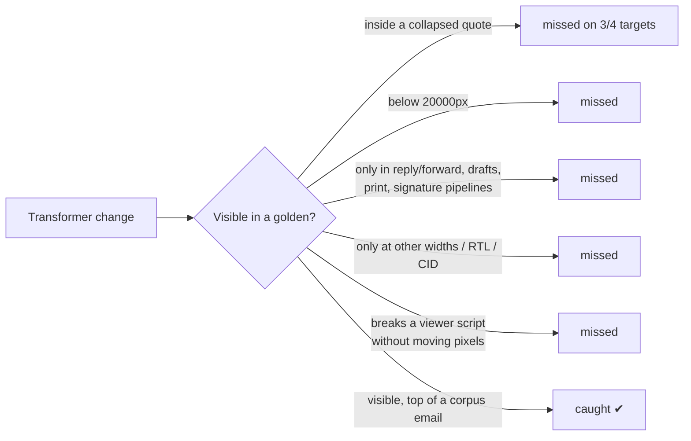

# 01 · Starting point (branch `feature/html-render-golden`)

## What exists

| Piece | Path | Role |
|---|---|---|
| Document builder | `core/lib/presentation/views/html_viewer/html_viewer_document_builder.dart` | Builds the exact HTML document each viewer loads; the three viewer widgets now call it |
| Plain text config | `TransformConfiguration.forPlainTextEmail()` | Plain-text pipeline extracted from `HtmlAnalyzer` so tests can reuse it |
| Fixture emails | `core/test/html_render_golden/emails/*.gz` | 37 scrubbed real emails (34 HTML, 3 plain text), gzipped |
| Targets | `core/test/html_render_golden/render_target.dart` | `RenderTarget` enum: viewer, engine, pane width, app padding |
| Export step | `core/test/html_render_golden/export_render_documents_test.dart` | `flutter test` that writes one viewer document per email × target, plus `cases.json` and web fonts |
| Screenshot step | `core/html_render_golden/render.spec.ts` + `playwright.config.ts` | Loads each document offline and compares a screenshot |
| Runner | `core/html_render_golden/run.sh` | Runs export, then Playwright inside `mcr.microsoft.com/playwright:v1.52.0-noble` (linux/amd64) |
| Goldens | `core/html_render_golden/goldens/*.png` | 148 PNGs = 37 emails × 4 targets |
| CI | `.github/workflows/html-render-golden.yaml` | Path-filtered PR job + manual "update" dispatch |

## Pipeline today

## Run sequence

Why it measures, then reloads: resizing a loaded page re-runs the viewer's responsive layout script; a reload lays out once at the final size.

## What it does well

- Exercises the production code path: the same `HtmlTransform` configs and the same `HtmlViewerDocumentBuilder` the widgets use. The refactor maps the widget getters one to one (`html_content_viewer_widget.dart:79-112`), so the document under test is the document the app loads.
- Deterministic: offline, placeholder images sized from the URL, lazy images forced eager, pinned browser image, `maxDiffPixelRatio: 0`.
- Real-world corpus instead of synthetic HTML.

## Gaps (measured on the branch)

| # | Gap | Evidence | Effect |
|---|---|---|---|
| G1 | CI never runs upstream | `if: github.repository == 'tddang-linagora/tmail-flutter'` | No protection on `linagora/tmail-flutter` |
| G2 | Quoted content stays collapsed | `eml-12` is 200px on web / native-android / native-ios (only the "•••" button) and 6680px on ios-previewer | Changes inside blockquotes are invisible on 3 of 4 targets |
| G3 | Native targets are proxies | Linux fallback fonts (not Roboto / Helvetica), WebKitGTK ≠ WKWebView, `Desktop Chrome` has `isMobile: false` | Catches relative change; does not prove device correctness |
| G4 | Truncation only annotates | `ios-previewer-eml-20.png` is exactly 20000px tall | Tail of long emails unchecked |
| G5 | JS errors not observed | No `pageerror` listener; Android document includes `scriptsHandleContentSizeChanged`, which calls `window.flutter_inappwebview.callHandler` unguarded and throws in Playwright | A broken viewer script passes if pixels happen to match |
| G6 | App geometry duplicated | `RenderTarget` hardcodes 12+12 / 16+16 padding, 390 / 1000 widths, 16 / 14 font size | App layout changes do not move the goldens; path filter does not include `email_view.dart` or `email_view_styles.dart` |
| G7 | Narrow matrix | One width per target, `direction: null`, no CID map | Responsive, RTL and inline-image regressions uncovered |
| G8 | Two pipelines only | Preview (native/web) and plain text | Composer, drafts, print, signature, calendar pipelines uncovered |
| G9 | Path filter incomplete | Missing `lib/features/email/data/local/html_analyzer.dart`, viewer callers | Relevant PRs skip the job |

## Coverage today, per target

| Target | Engine (proxy) | Pane | Font | Viewer features | Quotes |
|---|---|---|---|---|---|
| native-android | Chromium desktop | 390 | 16 | quoteToggle, mobileResponsiveLayout | collapsed |
| native-ios | WebKitGTK | 390 | 16 | quoteToggle, mobileResponsiveLayout | collapsed |
| web | Chromium desktop | 1000 | 14 | quoteToggle | collapsed |
| ios-previewer | WebKitGTK | 390 | 16 | none | always visible |

## Where each piece went

| Starting point | Now |
|---|---|
| `HtmlViewerDocumentBuilder`, `forPlainTextEmail()` (commits kept with their author) | unchanged, in `core` |
| `core/test/html_render_golden/emails/*.gz` | `golden/corpus/emails/` + `manifest.json` (+ fabricated `eml_45`, `eml_46`) |
| `RenderTarget` with hardcoded geometry | `EmailViewTarget` reading `EmailViewStyles`, `ResponsiveUtils`, `ConstantsUI` |
| `export_render_documents_test.dart` | `golden/suites/email_view_html/test/export_documents_test.dart` via `defineRenderExport` |
| `core/html_render_golden/render.spec.ts` | generic `golden/playwright/runner/` + `golden/suites/email_view_html/playwright/suite.ts` |
| `run.sh` | `golden/run.sh` (all suites, `--update`, `--mutation`) |
| `html-render-golden.yaml` (fork only) | `golden.yaml` (affected suites + gate) and the `golden` module of `analyze-test.yaml` |
| 148 flat PNGs | `goldens/pixel/<target>/<width>/<state>-<dir>/…`, regenerated with font profiles |

| Gap | Closed by |
|---|---|
| G1 fork-only CI | `golden.yaml` runs upstream |
| G2 collapsed quotes | L1 snapshots + `expanded` pixel state |
| G3 proxies | font profiles, mobile flags (still proxies; L4 planned) |
| G4 truncation | tiles |
| G5 JS errors unseen | bridge stub + `no-page-errors` |
| G6 duplicated geometry | geometry read from app constants |
| G7 narrow matrix | `responsive` and `rtl` tiers |
| G8 two pipelines | 13 pipelines in four suites |
| G9 path filter | per-suite `triggerPaths` + shared paths |
