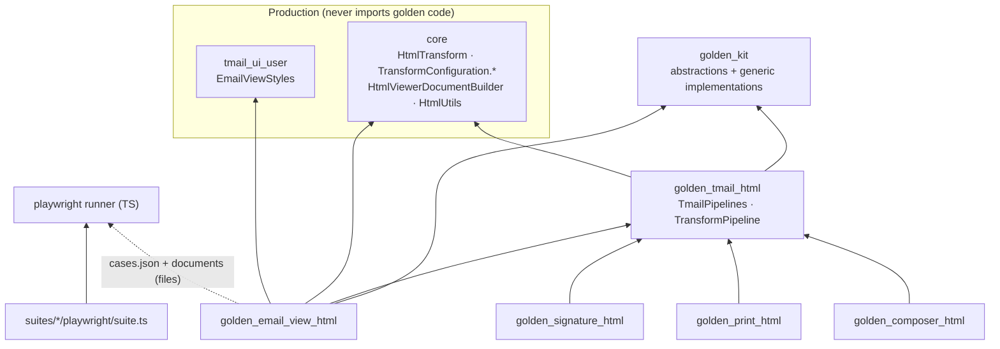
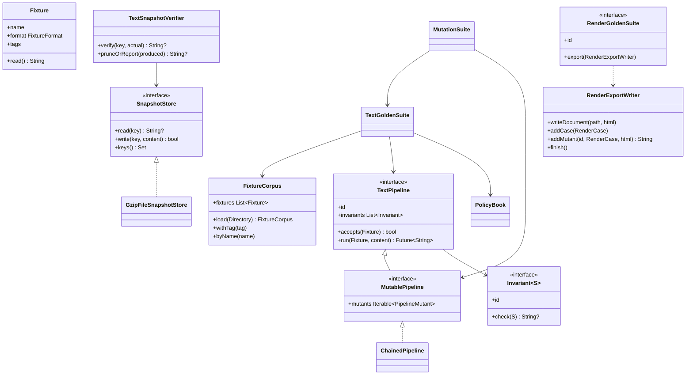
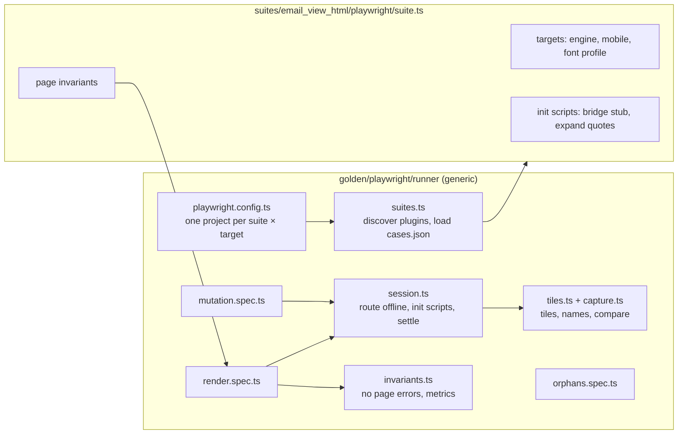

# 02 · Platform architecture

The golden tests are a small platform, not one test: email view HTML is its first suite, and other surfaces (composer, print, signatures, later calendar events or widget goldens) are suites of their own. This file describes how it is organized and why.

## Layout

```text
golden/
├── README.md                     quickstart
├── run.sh                        single entry point: verify | --update | --mutation
├── kit/                          golden_kit            generic framework, no production dependency
├── adapters/tmail_html/          golden_tmail_html     the app's HTML pipelines, offline
├── corpus/                       data only
│   ├── emails/                   eml_*.html.gz, eml_*.txt.gz, manifest.json
│   └── signatures/               sig_*.html.gz, manifest.json
├── suites/                       one package per product surface
│   ├── email_view_html/          golden_email_view_html   text + pixel
│   ├── composer_html/            golden_composer_html     text
│   ├── print_html/               golden_print_html        text
│   └── signature_html/           golden_signature_html    text
├── playwright/                   generic pixel runner (npm), Dockerfile, font profiles
└── tool/                         CI helpers (affected suites)
```

Every suite has the same shape:

```text
golden/suites/<suite>/
├── suite.json            id, kinds (text, pixel), corpora, trigger paths — read by CI
├── policies.json         per-fixture deviations, each with a reason (optional)
├── pubspec.yaml          golden_<suite>
├── lib/                  what the suite checks (targets, pipelines, mutants)
├── test/                 text_goldens_test.dart, export_documents_test.dart, unit tests
├── playwright/suite.ts   pixel plugin: targets, init scripts, page invariants (pixel suites)
└── goldens/
    ├── text/<pipeline>/<fixture>.html.gz
    └── pixel/<target>/<width>/<state>-<dir>/<fixture>[-t<k>].png
```

## Dependency rules



| Rule | Enforced by |
|---|---|
| Production never imports a golden package | `golden/kit/test/architecture_boundaries_test.dart` scans every production `lib/` |
| The kit depends only on the SDK and generic packages (`html`, `collection`) | its `pubspec.yaml` (nothing else resolvable) and the same boundary test |
| A suite never imports another suite | boundary test; shared code goes to the kit (generic) or the adapter (tmail-specific) |
| Dart and TypeScript share only files | `cases.json` carries `schemaVersion`; the runner rejects any other version |
| A plugin imports only types and plain functions from the runner | plugins live outside `golden/playwright/node_modules`; only type imports and dependency-free modules resolve |

## SOLID, concretely

| Principle | Where it shows |
|---|---|
| Single responsibility | `FixtureCorpus` loads and validates fixtures; `SnapshotStore` stores; `TextSnapshotVerifier` compares; each `Invariant` checks one property; `PolicyBook` holds expectations; `RenderExportWriter` writes the runner contract. Content tags live in the corpus manifest, expectations in each suite's `policies.json`. |
| Open/closed | A new suite is a new folder implementing kit interfaces: no change in the kit, the runner, `run.sh` or the workflows (CI reads `suite.json`; the runner discovers `suite.ts`). A new transformer in a production `TransformConfiguration` is mutated automatically. |
| Liskov | Every `TextPipeline` (`TransformPipeline`, `ChainedPipeline`, test fakes) is run, snapshotted and mutated the same way; mutants are themselves `TextPipeline`s. |
| Interface segregation | `TextPipeline` (run), `MutablePipeline` (run + mutants), `RenderGoldenSuite` (export) and `SuitePlugin` (targets, init scripts, invariants) are separate; a text-only suite implements none of the pixel parts. |
| Dependency inversion | The kit defines abstractions; the adapter implements them with production code; suites compose. The runner depends on the `SuitePlugin` shape, not on any suite. |

## Kit classes



Registration helpers keep each test file to a few lines: `defineTextGoldenTests(suite)`, `defineMutationTests(MutationSuite(suite, explainedSurvivors: ...))`, `defineRenderExport(renderSuite)`.

## Adapter

`TmailPipelines` is the one catalog of the app's HTML pipelines, so no suite rebuilds one or picks its own invariants:

| Pipeline id | Production factory | Called from | Invariants |
|---|---|---|---|
| `preview-native` | `forPreviewEmail()` | `EmailDataSourceImpl`, `SingleEmailController` | sanitizing |
| `preview-web` | `forPreviewEmailOnWeb()` (built as web) | same, on web | sanitizing |
| `plain-text` | `forPlainTextEmail()` | `HtmlAnalyzer` | sanitizing |
| `reply-forward`, `reply-forward-empty` | `forReplyForward[Empty]Email()` | composer setup | preserving |
| `drafts`, `restore` | `forDraftsEmail()`, `forRestoreEmail()` | composer, interactor | sanitizing |
| `edit-drafts-native`, `edit-drafts-web` | `forEditDraftsEmail()` (both platforms) | composer setup | sanitizing |
| `print-native`, `print-web` | preview output → `forPrintEmail()` (`ChainedPipeline`) | `EmailActionReactor.printEmail` passes `emailLoaded.htmlContent` | sanitizing (end to end) |
| `signature-identity` | `forSignatureIdentity()` | `IdentityDataSourceImpl` | sanitizing |
| `composer-signature` | `forComposerSignature()` | `ComposerController` | preserving |

"Sanitizing" adds `SafeHtmlInvariant` to the preserving ones. `tmail_pipelines_test.dart` runs a hostile probe through every pipeline and checks each claim, so the catalog cannot drift from the production wiring.

## Runner and plugin



A plugin answers three questions only: which targets (engine, mobile flags, font profile), which scripts to install before the page runs, and which page invariants must hold. Everything else (offline routing, settling, tiling, golden naming, mutation, orphans) is the runner's.
