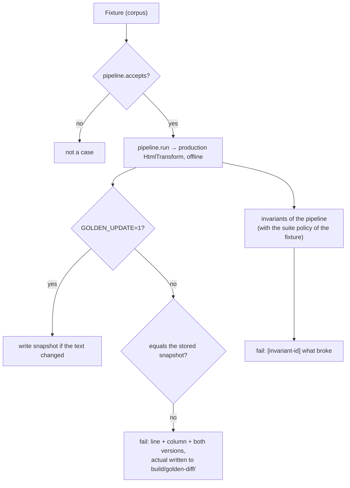
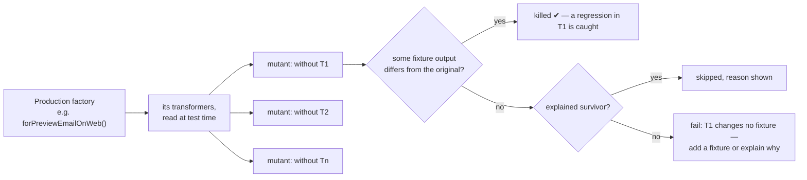

# 03 · Text goldens (L1)

## Why first

A transformer or sanitizer change is, before anything else, a change of the HTML string a pipeline returns. Comparing that string is exact, runs in the Dart VM in seconds, and covers what pixels cannot: content inside collapsed quotes, content below any screenshot limit, and pipelines no viewer displays (composer, print, signatures).

## Flow of one case



One test per `pipeline × fixture` (`<pipeline>/<fixture> SHOULD match its snapshot and invariants`), plus two consistency tests per suite: no stored snapshot without a case (orphans), and no policy naming an unknown fixture or pipeline.

## Invariants

A snapshot says "changed"; an invariant says "wrong", and still fails after a careless snapshot update.

| Invariant | Checks | Applied to |
|---|---|---|
| `text-preserved` | Every body word of the input is in the output. Words are joined across inline tags and split at blocks, so `<user@x>` autolinked to `&lt;<a>user@x</a>&gt;` stays one word; hidden preheaders count. | every pipeline |
| `links-and-images-preserved` | `a[href]` and `img` counts do not drop | every pipeline |
| `safe-html` | no `<script>`, no `on*` handler, no `javascript:` URL (case and whitespace insensitive) | sanitizing pipelines only |

Allowed deviations live in the suite's `policies.json`, each with a mandatory `reason`; unknown keys or pipelines fail loudly instead of being ignored.

## Mutation proof: can these goldens fail?



`TransformPipeline.mutants` removes one DOM or text transformer at a time from the production configuration, so:

- a transformer **added** to a configuration gets a mutant automatically and fails until a fixture exercises it;
- a transformer **removed** or **changed** shows up as a snapshot diff on the fixtures that exercise it;
- `ChainedPipeline` (print) mutates only its last stage; the first stage is mutated by its own suite.

Original outputs are computed once per fixture and shared by all mutants of a pipeline.

### First run findings (kept as data, not hidden)

| Mutant | Outcome | Action taken |
|---|---|---|
| `plain-text/without PersistPreformattedTextTransformer` | no plain-text fixture had a table | fabricated `eml_46` (ASCII and Markdown table) → killed |
| `print-*/without RemoveLazyLoadingForBackgroundImageTransformer` | print ran on raw email | print now chains preview → print as production does → killed |
| `signature-identity/without BlockQuotedTransformer`, `…BlockCodeTransformer` | no signature with quote or code | fabricated `sig_5` → killed |
| `preview-*/without RemoveScriptTransformer`, `signature-identity/…` | the sanitizer text transformer strips `<script>` first | explained survivor (defense in depth) |
| `preview-*/without RemoveCollapsedSignatureButtonTransformer`, `print-*/…` | the sanitizer strips `<button>` first | explained survivor; the composer suite (no sanitizer) kills it |
| `print-*/without RemoveMaxWidthInImageStyleTransformer` | **production gap**: it removes the literal `max-width:100%;`, but the sanitizer re-serializes styles as `max-width: 100%;`, so printing never drops it (e.g. `eml_15`) | explained survivor marked `KNOWN GAP`, to remove once fixed |

Invariant findings handled through policies: `eml_44` (the sanitizer drops `twakemail.mobile:` and `zoommtg:` hrefs, link text stays), `eml_45` (the collapsed-signature toggle and its `...` label are removed on purpose), `sig_4` (`javascript:` href dropped).

## Proof on production code

Changing one value in `BlockQuotedTransformer` (`margin-left: 4px` → `2px`) fails three real emails:

```text
email_view_html text goldens preview-native/eml_6 SHOULD match its snapshot and invariants [E]
  first difference at line 1, column 185 (expected 1245 lines, actual 1245):
  - 1:185: …pe="cite" style="          margin-left: 4px;
  + 1:185: …pe="cite" style="          margin-left: 2px;
```

## Storage and size

Snapshots are gzipped like the fixtures (`.gitattributes` declares `diff=gzip`; `git config diff.gzip.textconv "gzip -dc"` makes local diffs readable) and rewritten only when their text changes, so regenerating on another OS does not churn files. The four suites store 374 snapshots, about 2 MB.

## Run

```bash
cd golden/suites/email_view_html && flutter test             # verify
cd golden/suites/email_view_html && GOLDEN_UPDATE=1 flutter test   # update + prune orphans
bash golden/run.sh --text                                    # every suite
```

CI runs them in `analyze-test.yaml` (module `golden`, every golden package in turn).
