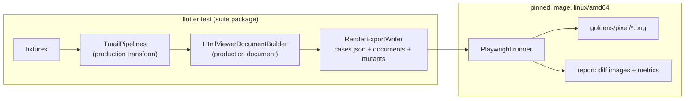
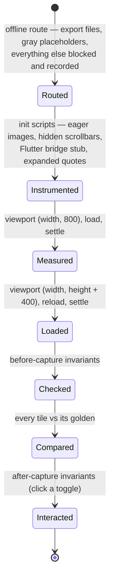
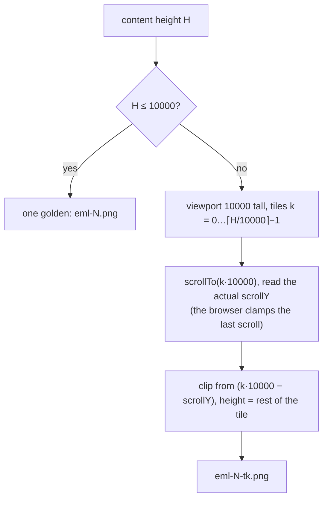

# 04 · Pixel goldens (L2) and page invariants (L3)

## Pipeline

The export calls the same `TransformConfiguration` factories and the same `HtmlViewerDocumentBuilder` the widgets use; geometry comes from `EmailViewStyles`, `ResponsiveUtils` and `ConstantsUI`, so a layout change in the app moves the goldens.

## Email view cases

| Target | Viewer | Engine (proxy) | Font profile | Standard body width | Extra widths (tag `responsive`) |
|---|---|---|---|---|---|
| `native-android` | `HtmlContentViewer` | Chromium, mobile | Roboto / Noto | 414 (pane 390) | 320, 768 |
| `native-ios` | `HtmlContentViewer` | WebKit, mobile | Liberation (Helvetica metrics) | 414 (pane 390) | 320, 768 |
| `web` | `HtmlContentViewerOnWeb` | Chromium, desktop | TwakeInter served | 1032 (pane 1000) | 632, 1432 |
| `ios-previewer` | `IosHtmlContentViewerWidget` | WebKit, mobile | Liberation | 414 (no padding) | 320, 768 |

States: `collapsed` (as opened) for every case, plus `expanded` when the viewer inserted a quote toggle. Direction: `ltr`, plus `rtl` for fixtures tagged `rtl`. 40 fixtures give 256 cases.

## Lifecycle of one case

`settle` waits for `document.fonts.ready`, decodes every image, then waits until the content height is unchanged for two animation frames; a height still moving after 15 s fails the case instead of capturing a half-laid-out page.

## Fidelity of the proxies

| Measure | Why |
|---|---|
| One Playwright project per target, `isMobile` / `hasTouch` on phone targets | honors `<meta name="viewport">` and overlay scrollbars like a phone webview |
| `fontconfig/android.conf`: `sans-serif` → Roboto, `serif` → Noto Serif, `monospace` → Noto Mono; Liberation and other desktop fonts rejected | an Android WebView has no Arial or Helvetica; emails asking for them fall back to Roboto |
| `fontconfig/ios.conf`: `sans-serif`/`Helvetica` → Liberation Sans, `serif` → Liberation Serif, `monospace` → Liberation Mono | Helvetica cannot ship; Liberation Sans is metric-compatible with Arial, whose metrics match Helvetica |
| Font packages pinned by version in the Dockerfile, base image pinned by digest | a font update fails the build instead of moving pixels |
| Hidden scrollbars | the app sizes the webview to the content, so no scrollbar takes width |
| Bridge stub `window.flutter_inappwebview.callHandler` | viewer scripts call it unguarded; it records calls for the content-size invariant |

Still different from devices (left to L4): WKWebView text autosizing, Android text zoom, device pixel ratio, SF Pro.

## Long emails

Nothing is truncated any more: every pixel of every email is compared.

## Names and comparison

`goldens/pixel/<target>/<width>/<state>-<dir>/<fixture>[-t<k>].png`, sanitized like Playwright does (`eml_12` → `eml-12`). `maxDiffPixelRatio: 0` with the default per-pixel `threshold`: the image is deterministic, so any differing pixel is a change. Masks are never used on email content.

`--update` deletes the suite's pixel goldens, regenerates them, then shrinks them losslessly with `optipng` (pinned in the image; about a third smaller, and Playwright compares decoded pixels, so nothing else changes). Goldens of removed cases do not linger; verify runs fail on any stored golden no exported case produces (`orphans.spec.ts`).

## Page invariants (email view plugin)

| Invariant | Phase | Applies to | Fails when |
|---|---|---|---|
| `no-page-errors` (generic) | before | all | an uncaught error, a rejected promise or a `console.error` that is not a resource load |
| `only-design-fonts-missing` | before | all | the document asks for an export file that does not exist, except the design fonts on native targets (they 404 on devices too) |
| `no-horizontal-overflow` | before | phone targets, unless the policy allows the target | `scrollWidth > innerWidth` |
| `content-size-reported` | before | native-android | the content-size channel was never called |
| `design-font-loadable` | before | web | `document.fonts.load("14px TwakeInter")` finds no face or a face fails to load |
| `quote-toggle-works` | after | collapsed cases with a toggle | clicking it does not reveal the quote |
| `body-resize-reported` | after | native-android | growing the body does not call the content-size channel again (the responsive script only reports window resizes) |

Soft metrics (height, scroll width, images, links, blocked requests, missing files) are attached to each test in the HTML report to explain a pixel diff; they are not a gate.

## Mutation proof for scripts and styles

The export also writes mutant documents: the case's document with one production block removed (`withoutPart` fails the export if the block is no longer there, so the list cannot go stale).

| Mutant | Removed block | Targets | Expected detection |
|---|---|---|---|
| without quote toggle style | `HtmlUtils.quoteToggleStyle` | web, native-android | collapsed quotes appear → pixels |
| without quote toggle script | `HtmlUtils.quoteToggleScript` | web, native-android | `quote-toggle-works` |
| without image normalize script | `generateNormalizeImageScript` | native-android, web | an image wider than the pane (tag `wide-image`) → pixels / overflow |
| without mobile responsive layout script | `MobileEmailResponsiveLayoutScript` | native-android, native-ios | overflow / pixels |
| without lazy background image script | `scriptsHandleLazyLoadingBackgroundImage` | native-android, web | documents containing `lazy=""` lose their backgrounds → pixels |
| without content size script | `scriptsHandleContentSizeChanged` | native-android | `body-resize-reported` |
| without font faces | `HtmlTemplate.fontFaceStyle` | web | `design-font-loadable` |
| without default font style | `HtmlTemplate.defaultFontStyle` | native-ios, web | pixels |

`bash golden/run.sh --mutation` renders each mutant on up to three cases per target, chosen by fixture tag, state and, when set, a marker the document must contain (the block has to have something to act on). A mutant that neither breaks an invariant nor changes a golden on a target fails the run as a survivor; a target without any candidate case fails the export.

### Result

`bash golden/run.sh --suite email_view_html --mutation`: 14 of 14 mutant × target checks detected.

| Mutant | Target | Killed by |
|---|---|---|
| without quote toggle style | native-android, web | `eml_6`: pixels differ |
| without quote toggle script | native-android, web | `eml_6`: `quote-toggle-works` |
| without image normalize script | native-android, web | `eml_47`: pixels differ |
| without mobile responsive layout script | native-android, native-ios | `eml_1`: pixels differ |
| without lazy background image script | native-android, web | `eml_47`: pixels differ |
| without content size script | native-android | `eml_1`: `body-resize-reported` |
| without font faces | web | `eml_1`: `design-font-loadable` |
| without default font style | native-ios, web | `eml_19`: pixels differ |

### What the first mutation run found

| Survivor | Cause | Fix |
|---|---|---|
| content size script | the invariant only checked one call, and the responsive script also calls the channel once | new `body-resize-reported` invariant: the Android script is what reports later body resizes |
| image normalize script on web | no fixture had an image wider than the 1000 px pane | fabricated `eml_47` with a 1600 px banner (tag `wide-image`) |
| lazy background script | `eml_11` had no lazy background after the transform; `eml_12`'s are inside a collapsed quote | `eml_47` with a visible lazy hero, the `lazy=""` marker, and case selection per target |
