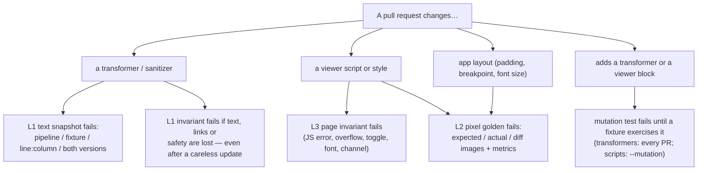

# 05 · How a regression is caught, and where it points

## By kind of change

| Change | First signal | What the failure names | Typical action |
|---|---|---|---|
| Edit a transformer | L1 snapshot | `preview-web/eml_12`, line 1 col 332, old vs new attribute | intended → `--update`, commit goldens separately; else fix |
| Remove a transformer | L1 snapshots of the fixtures it touched | every affected pipeline × fixture | same |
| Add a transformer | L1 mutant `pipeline/without NewTransformer` | "changes no fixture" | add a fixture that exercises it |
| Break sanitizing | L1 `safe-html`, plus `tmail_pipelines_test` | handler / script / `javascript:` found | fix |
| Drop body text or links | L1 `text-preserved` / `links-and-images-preserved` | lost words or counts | fix, or a policy with a reason |
| Edit a viewer script/style | L2 tiles, L3 invariants | case id, invariant id, diff image | intended → `--update`; else fix |
| Remove a viewer block | L3 / L2; `--mutation` proves it | mutant id and the case that killed it | — |
| Change app padding / breakpoint | L2 (geometry read from app constants) | every case of the target | `--update` |
| A script throws | L3 `no-page-errors` | the error message | fix |
| A fixture starts needing the network | L3 metrics (`blockedRequests`), `only-design-fonts-missing` for local files | the URL | scrub the fixture |

## Reading the order of failures

L1 runs on every pull request in the unit-test job; L2/L3 run in the golden job for the affected suites.

| L1 | L2/L3 | Meaning |
|---|---|---|
| red | red | the transformer output changed; L2 shows its visual effect |
| green | red | the viewer document changed (script, style, geometry), not the transformers |
| red | green | an output change with no visible effect (attribute order, hidden part, a pipeline no viewer shows) |
| green | green | no observable change for the corpus |

## What can still slip

| Gap | Why | Mitigation |
|---|---|---|
| Kinds of email no fixture represents | goldens only see the corpus | every rendering bug adds a scrubbed fixture (07); coverage tags |
| WKWebView / Android WebView engine specifics | L2 uses desktop engines as proxies | L4 device smoke (06) |
| Baselines that encode an existing bug | a golden records today's rendering | first-baseline review; known bugs listed in the roadmap; mutation survivors marked `KNOWN GAP` |
| Interactions beyond the quote toggle | not modeled | add a plugin invariant when a feature needs it |
