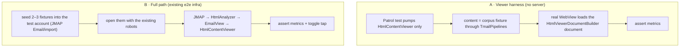

# 06 · Device smoke (L4) — planned

Not implemented yet. L2 renders in desktop engines that approximate phone webviews; L4 is the only layer that runs the real `HtmlContentViewer` in a real Android WebView and iOS WKWebView with the real JS bridge. It checks metrics and behavior, not pixels.

## Why not pixel goldens on devices

| Source of noise | Effect on a device screenshot |
|---|---|
| GPU / emulator backend | anti-aliasing differs between CI hosts |
| System fonts and hinting per OS version | line breaks move after an OS update |
| Android System WebView auto-updates | baselines break with no app change |
| Status bar, clock, safe areas | pixels outside the content change every run |

## Two flavors

## Checks

| Check | How |
|---|---|
| Height reported through the bridge | viewer widget height > min height and stable |
| No horizontal overflow unless the policy allows it | `scrollWidth ≤ innerWidth` via `evaluateJavascript` |
| No JS errors | console messages captured during load |
| Quote toggle works | tap → widget height grows |
| iOS clipping | a very long fixture triggers `onContentClipped` |

## Open points

- A device cannot read `golden/corpus` from the host: fixtures for flavor A must be embedded at build time (a generated, git-ignored Dart file, like `integration_test/resources/test_images.dart` embeds images), from the five fixtures tagged `device-smoke`.
- `HtmlContentViewer` exposes neither its controller nor console messages; reading them needs a small test hook. If that changes the widget's public contract, record it as an ADR.
- Schedule: nightly and before releases, not per pull request; a failure opens an issue with the metrics attached.
