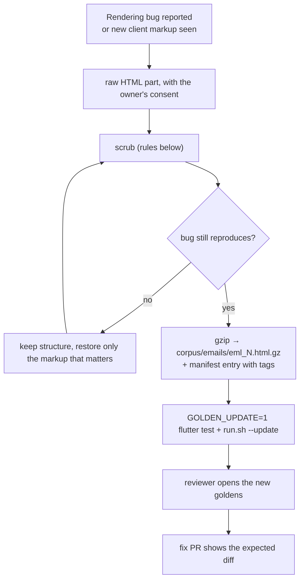

# 07 · Fixture corpus

The corpus decides what the tests can see: a regression in a kind of email no fixture represents passes every layer.

## Layout and manifest

```text
golden/corpus/
├── emails/       eml_*.html.gz (37 scrubbed real, 3 fabricated: eml_45-47), eml_*.txt.gz, manifest.json
└── signatures/   sig_*.html.gz (fabricated), manifest.json
```

```json
{
  "schemaVersion": 1,
  "fixtures": {
    "eml_12": {"format": "html", "tags": ["background-images", "images", "line-height", "links", "quotes", "tables", "wide-content"]},
    "eml_46": {"format": "text", "tags": ["ascii-table", "fabricated", "markdown-table", "plain-text"]}
  }
}
```

`FixtureCorpus.load` fails loudly when a file and the manifest disagree, when a gzipped file has an unknown suffix (a typo), when the declared format does not match the extension, or when an entry has an unknown key.

The corpus describes **content** (tags). **Expectations** belong to each suite: `golden/suites/<suite>/policies.json`, every entry with a `reason`.

## Tags that change the cases

| Tag | Effect |
|---|---|
| `responsive` | email view also renders at the extra widths of each target |
| `rtl` | email view also renders right to left |
| `quotes`, `wide-image`, `wide-content`, `background-images`, `links`, `signature` | fixtures the email view JS/CSS mutants are rendered on |
| `device-smoke` | the five fixtures for L4 |
| `fabricated` | written for a test, not scrubbed from a real email |

The other tags (`tables`, `outlook`, `gmail`, `apple-mail`, `code`, `cid-images`, `negative-margin`, `script`, `event-handlers`, …) document coverage.

## Coverage rule

The corpus is complete enough for a suite when every transformer mutant of its pipelines is killed or explained (03), and every viewer mutant is detected (04). A transformer nobody exercises fails the build until a fixture is added.

## Adding a fixture



## Scrubbing rules

Fixtures are public. Nothing in them may identify a person or an organization.

| Content | Replace with |
|---|---|
| Names, addresses, phone numbers | random words of similar length |
| Email addresses | `user@example.invalid` style |
| Body text | random words, same length per text node, same script (keep RTL / CJK / accented scripts) |
| Image URLs | `https://fixture.invalid/img/<W>x<H>` with the original intrinsic size; `cid:` → `https://fixture.invalid/cid/<W>x<H>` |
| Link URLs | `https://linkN.invalid/...`, keeping the scheme (`mailto:`, `tel:`, `javascript:`, app schemes) because sanitizers branch on it |
| Tracking pixels, tokens in query strings | removed or replaced |
| Markup, CSS, class names | kept |

Grep the decompressed file for `@` outside `.invalid`, phone-like digit runs and real domains before committing. Never paste a real email into a test, even temporarily.
