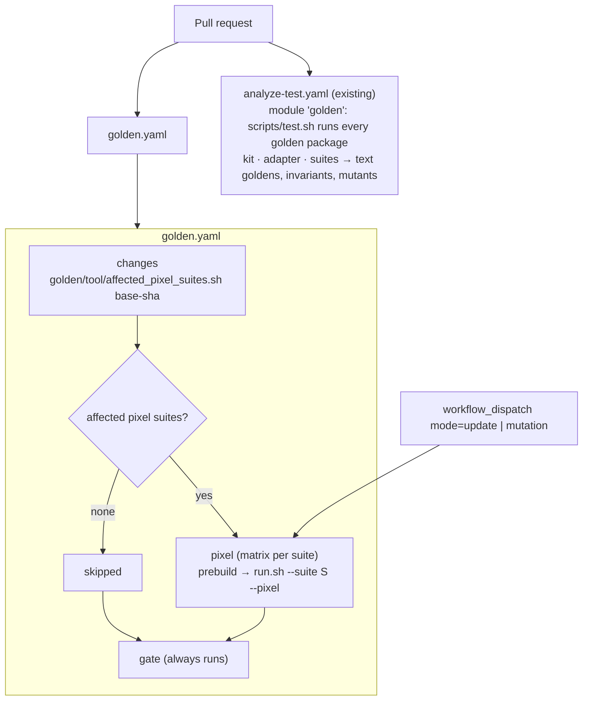
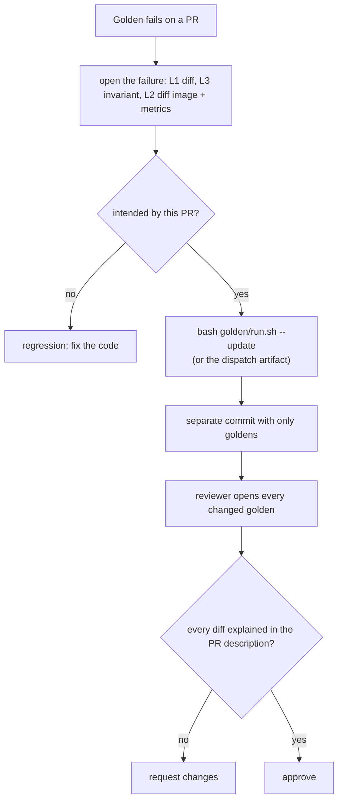

# 08 · CI and baseline workflow

## Jobs

| Job | Trigger | Output on failure |
|---|---|---|
| `analyze-test / golden` | every pull request | failing test with snapshot diff or invariant message; `test-report-golden-*.json` |
| `golden / changes` | every pull request | list of affected pixel suites |
| `golden / pixel` | affected suites only | Playwright report: expected / actual / diff images, metrics |
| `golden / gate` | always | fails if `changes` failed or `pixel` did not succeed |
| dispatch `update` | manual | regenerated pixel goldens as an artifact |
| dispatch `mutation` | manual | which case killed each viewer mutant, or the survivors |

A suite is affected when a changed file matches a `triggerPaths` pattern of its `suite.json`, lies inside the suite, or lies in shared golden code or data (`golden/kit`, `golden/adapters`, `golden/corpus`, `golden/playwright`, `golden/run.sh`, `golden/tool`, `pubspec.lock`, the workflow). Adding a suite needs no workflow change.

`gate` exists because a skipped workflow never reports a status and so cannot be a required check.

## When a golden fails

Rules:

- CI never updates goldens on a pull request; an auto-updated baseline accepts the regression it should catch.
- Regenerate with `run.sh` (same image, same pixels as CI) or the dispatch artifact.
- Golden updates go in their own commit; the PR description lists which fixtures changed and why.
- Changing the Dockerfile, fonts or Playwright version regenerates every pixel golden, in a pull request with no code change.
- Run `--mutation` when the viewer document builder or its scripts change, and after adding a viewer block.

## First baseline acceptance

Goldens record today's rendering, bugs included. Before `golden / gate` becomes required, two people review every image (split by target) and every explained survivor; bugs found are listed in the roadmap and opened as issues.

## Privacy

Artifacts contain only scrubbed or fabricated fixtures and images rendered from them. The workflow has `contents: read` and no secrets. Test output never goes to Sentry or app logs.
