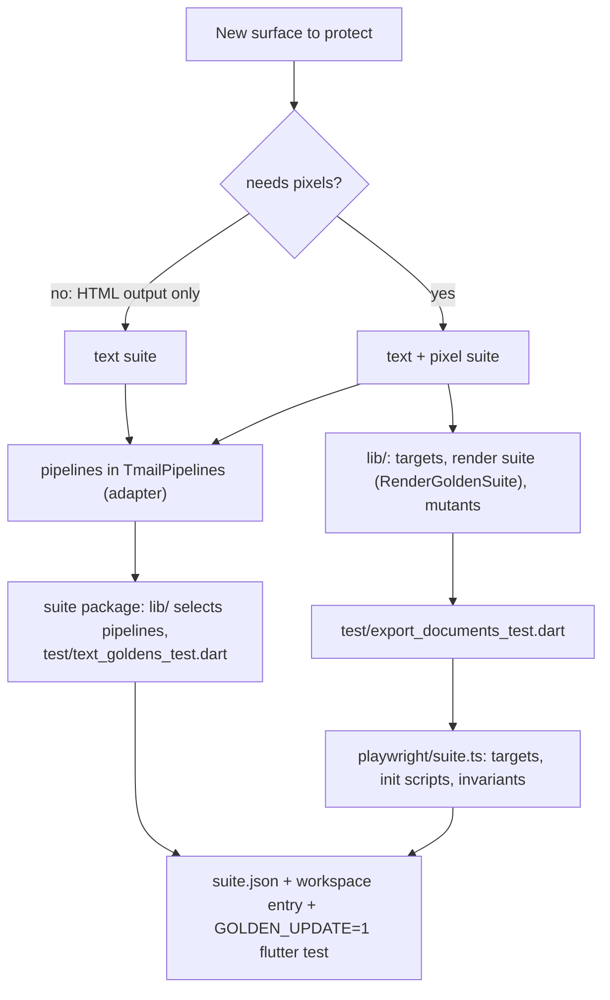

# 09 · Adding a suite

A suite covers one product surface. Adding one changes no shared code: the kit, the runner, `run.sh` and the workflows discover it.



## Text suite checklist

1. If the pipeline is new, add it to `TmailPipelines` (`golden/adapters/tmail_html`) with the invariants matching its wiring; `tmail_pipelines_test.dart` will check the sanitizing claim.
2. Create `golden/suites/<suite>/` with `pubspec.yaml` (`name: golden_<suite>`, `resolution: workspace`, depends on `golden_kit` and `golden_tmail_html`), and add the folder to `workspace:` in the root `pubspec.yaml`.
3. `lib/golden_<suite>.dart`: a function returning the suite's pipelines from `TmailPipelines`.
4. `test/text_goldens_test.dart`:

   ```dart
   void main() {
     final layout = GoldenLayout.current();
     final suite = TextGoldenSuite(layout: layout, corpus: layout.corpus('emails'), pipelines: myPipelines());
     defineTextGoldenTests(suite);
     defineMutationTests(MutationSuite(suite));
   }
   ```

5. `suite.json`: `{"id": "<suite>", "kinds": ["text"], "corpora": ["emails"], "triggerPaths": [...]}`.
6. `GOLDEN_UPDATE=1 flutter test`, then `flutter test`. For each failure: fix, add a fixture, add a policy with a reason, or explain a surviving mutant with a reason (`KNOWN GAP: …` for a production bug).

## Pixel additions

7. `lib/`: targets (viewer, engine, geometry read from app constants), a `RenderGoldenSuite` that writes each case's document with the production builder, and mutants (`withoutPart` of each production block the builder injects).
8. `test/export_documents_test.dart`: `defineRenderExport(MyRenderSuite(...))`, plus a unit test that exports the real corpus so a stale mutant fails in the normal unit job.
9. `playwright/suite.ts`: default-export a `SuitePlugin` (`id` = suite id, `targets`, `initScripts`, `invariants`); import only types and plain functions from `golden/playwright/runner`.
10. `suite.json` kinds `["text", "pixel"]`, then `bash golden/run.sh --suite <suite> --update`, review every image, `bash golden/run.sh --suite <suite> --mutation`.

## Candidates

| Suite | Kinds | Notes |
|---|---|---|
| `calendar_event_html` | text | `forCalendarEvent()`; needs a fabricated `calendar/` corpus of event descriptions |
| `composer_editor_html` | pixel | the composer's editor document, if it gets a builder like the viewers |
| `print_html` pixels | pixel | print layout at A4 width with `page.emulateMedia({ media: 'print' })` as a plugin init step |
| widget goldens | new kind | Flutter `matchesGoldenFile` for chosen widgets; would reuse the corpus and naming but needs its own runner, so it is a new `kind` rather than a plugin |
