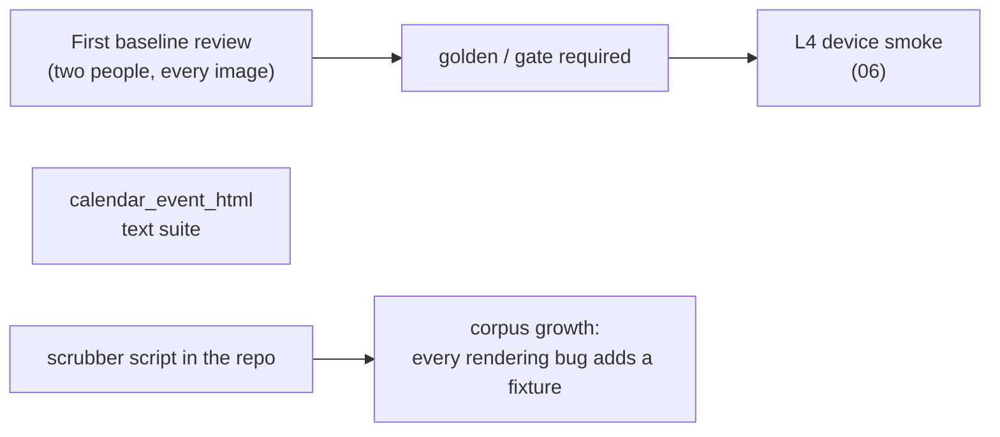

# 10 · Status and roadmap

## Done (branch `improvement/golden-testing-platform`)

| Area | What exists |
|---|---|
| Platform | `golden_kit`, `golden_tmail_html`, four suites, shared corpus, boundary test |
| L1 text | 374 snapshots over 13 pipelines, three invariants, transformer mutants with explained survivors |
| L2/L3 pixel | 256 email view cases on four targets, tiling, font profiles, page invariants, orphan check |
| Mutation for scripts/styles | 8 viewer mutants exported and rendered by `run.sh --mutation` |
| CI | `golden` module in `analyze-test.yaml`, `golden.yaml` with affected suites and a gate |
| Gaps of the starting point (01) | G1–G9 closed, G3 as far as proxies allow |

## Next

| Task | Done when |
|---|---|
| First baseline review | every pixel golden and explained survivor reviewed; bugs opened |
| Make `golden / gate` a required check | repository setting (maintainers) |
| `calendar_event_html` suite | fabricated calendar corpus; mutants of `forCalendarEvent()` killed |
| Scrubber script | new fixtures go through one tool, with the grep checks of 07 |
| L4 device smoke | 5 `device-smoke` fixtures pass nightly on emulator and simulator |

## Findings to triage (production)

| Finding | Evidence | Suggested follow-up |
|---|---|---|
| `RemoveMaxWidthInImageStyleTransformer` never fires when printing | it removes `max-width:100%;`; the preview sanitizer emits `max-width: 100%;` (eml_15 keeps 4 such images) | match the declaration through a CSS parser or both spellings, then drop the `KNOWN GAP` survivor |
| App-scheme links lose their href | sanitizer allowlist drops `twakemail.mobile:` and `zoommtg:` (eml_44) | confirm it is intended; if not, extend the allowlist |
| Collapsed TMail signature stays hidden in the viewer | the sanitizer removes the toggle button but keeps `.tmail-signature-content` with `display: none` (fabricated eml_45) | check whether received mail can still carry this markup |

## Risks

| Risk | Mitigation |
|---|---|
| Many images to review on a broad change | L1 explains the cause first; metrics in the report; separate golden commit |
| Careless baseline updates | invariants still fail; mutation proof; reviewer checklist |
| Run time and rare WebKit hangs under amd64 emulation on Apple Silicon | CI runs natively on amd64; locally use `--suite` and `--text`; no automatic retries, since a retry would also hide a flaky comparison |
| Repository size | 430 PNGs, about 52 MB after lossless optimization (77 MB raw), clipped to content height at DPR 1. Each regeneration of changed images adds to history: decide on Git LFS for `goldens/pixel` (maintainers) before the matrix grows |
| Proxy engines miss a WebKit/WebView-only bug | L4; add the case as a fixture once found |
