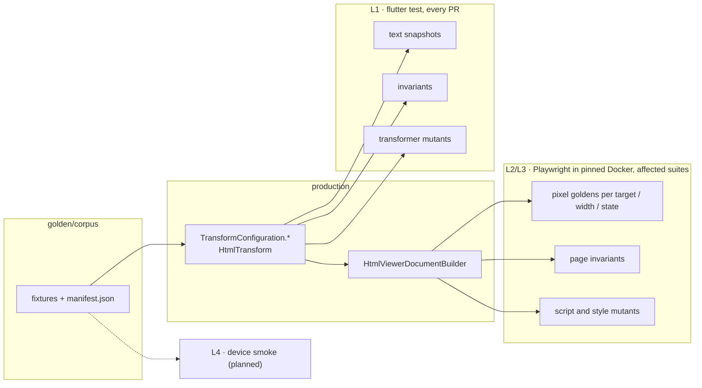

# Golden testing platform

Regression tests for everything that turns email HTML into what users see — transformers, sanitizer, viewer documents and their scripts — on web, Android and iOS. Email view HTML is the first suite; composer, print and signatures follow the same structure, and new surfaces are added as suites without touching shared code.

Quick commands live in [`golden/README.md`](../../../../golden/README.md).

## Goal

When a pull request changes a transformer, the sanitizer, a viewer script or style, or the viewer layout, every change in what users see surfaces in the pull request, the failure says where, and the goldens are proven able to fail.

## Non-goals

- Proving every email in the world renders "correctly": a golden proves "unchanged since the approved baseline, for this corpus, on this engine".
- Pixel-identical rendering across engines: each target has its own baseline.

## Reading order

| File | Content |
|---|---|
| [01-current-state.md](01-current-state.md) | The starting point (feature branch) and its gaps G1–G9 |
| [02-platform-architecture.md](02-platform-architecture.md) | Packages, dependency rules, SOLID, contracts |
| [03-text-goldens.md](03-text-goldens.md) | L1: text snapshots, invariants, transformer mutants |
| [04-pixel-goldens.md](04-pixel-goldens.md) | L2/L3: Playwright goldens, fonts, tiling, page invariants, script mutants |
| [05-how-regressions-are-caught.md](05-how-regressions-are-caught.md) | Which change fails which test, and what still slips |
| [06-device-smoke.md](06-device-smoke.md) | L4 on real webviews (planned) |
| [07-fixture-corpus.md](07-fixture-corpus.md) | Corpus, manifest, tags, scrubbing |
| [08-ci-and-workflow.md](08-ci-and-workflow.md) | CI jobs, gate, updating and reviewing goldens |
| [09-adding-a-suite.md](09-adding-a-suite.md) | Checklist for a new suite |
| [10-roadmap.md](10-roadmap.md) | Status, next steps, production findings |

## One picture

## Key decisions

| Decision | Why |
|---|---|
| Drive the production factories and builder, not the running app | same code as users get, offline, fast, deterministic |
| Text snapshots before pixels | exact, cheap, cover hidden and long content and pipelines no viewer shows |
| Prove the goldens can fail (mutants) | a passing golden only means something if removing any transformer or viewer block makes it fail |
| One pinned image, `maxDiffPixelRatio: 0` | identical pixels locally and in CI, so no tolerance hides a regression |
| One baseline per target, desktop engines labelled as proxies | engines differ; real devices are checked by metrics (L4) |
| Generic kit + adapter + suites | new surfaces become suites without touching shared code (02) |
| Every deviation needs a reason; typos fail | no silent loosening: unknown keys, missing files, stale mutants and orphans are errors |
